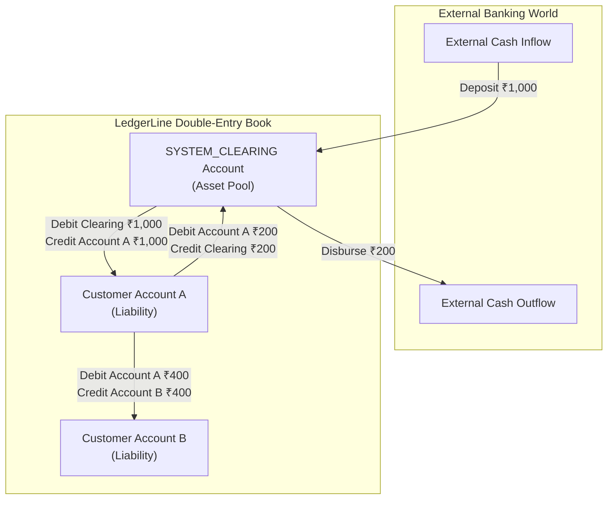

# LedgerLine — Comprehensive Architecture & Engineering Specification

## 1. Overview & Architectural Goals

LedgerLine is built to provide an unforgeable, provable ledger of money movements. Financial systems cannot tolerate lost updates, precision drift, unrecorded refusals, or uncoordinated state changes.

This document serves as the authoritative technical specification for LedgerLine's core domain, accounting engine, database design, and concurrency controls.

---

## 2. Double-Entry Accounting Model & Chart of Accounts

In LedgerLine, money cannot appear from or disappear into nothingness. Every posted financial transaction creates at least two balanced entries: a **Debit** and a **Credit**, satisfying:

$$\sum \text{Debits} - \sum \text{Credits} = 0.00 \text{ INR}$$

### Chart of Accounts
- **Customer Accounts (Liability Accounts)**: Represent deposits held by the bank on behalf of customers.
  - Normal Balance: Credit.
  - Increases with **Credit** (deposits, received transfers).
  - Decreases with **Debit** (withdrawals, sent transfers).
- **`SYSTEM_CLEARING` Account (Asset / Clearing Account)**: Dedicated internal account (`ACC-SYSTEM-CLEARING-001`) representing external cash reserves in the banking system.
  - Normal Balance: Debit.
  - Increases with **Debit** (external money entering the bank).
  - Decreases with **Credit** (external money disbursed to customers).

---

### Transaction Accounting Specifications



#### A. External Deposit (e.g., ₹1,000.00 into Account A)
External funds enter the bank's custody and are credited to the customer:
1. **Debit**: `SYSTEM_CLEARING` account by `₹1,000.00` (Clearing asset increases).
2. **Credit**: `Account A` by `₹1,000.00` (Customer liability increases).
- **Balance Equation**: $\text{Debit (₹1,000.00)} - \text{Credit (₹1,000.00)} = 0.00 \text{ INR}$.

#### B. External Withdrawal (e.g., ₹200.00 from Account A)
Customer requests funds disbursed to an external endpoint:
1. **Debit**: `Account A` by `₹200.00` (Customer liability decreases).
2. **Credit**: `SYSTEM_CLEARING` account by `₹200.00` (Clearing asset decreases).
- **Balance Equation**: $\text{Debit (₹200.00)} - \text{Credit (₹200.00)} = 0.00 \text{ INR}$.
- **Condition**: `Account A.balance - ₹200.00 >= 0.00`.

#### C. Internal Transfer (e.g., ₹400.00 from Account A to Account B)
Peer-to-peer reallocation between customers; `SYSTEM_CLEARING` is untouched:
1. **Debit**: `Account A` (Source) by `₹400.00` (Account A liability decreases).
2. **Credit**: `Account B` (Destination) by `₹400.00` (Account B liability increases).
- **Balance Equation**: $\text{Debit (₹400.00)} - \text{Credit (₹400.00)} = 0.00 \text{ INR}$.
- **Condition**: `Account A.balance - ₹400.00 >= 0.00`.

#### D. Reversal Accounting
Posted entries are immutable. Reversals create new compensating entries:
- Reversal of $A \rightarrow B$ for ₹400.00:
  - **Debit**: `Account B` by `₹400.00`.
  - **Credit**: `Account A` by `₹400.00`.
  - Condition: `Account B.balance - ₹400.00 >= 0.00`.

---

## 3. Money Conservation Invariant & Proofs

The global system invariant guarantees that total customer liabilities equal the net balance of the clearing account:

$$\sum_{i=1}^{N} \text{Balance}(\text{Customer Account}_i) = \text{Balance}(\text{SYSTEM\_CLEARING}) = \sum \text{External Deposits} - \sum \text{External Withdrawals}$$

$$\text{Net Position} = \text{Balance}(\text{SYSTEM\_CLEARING}) - \sum_{i=1}^{N} \text{Balance}(\text{Customer Account}_i) \equiv 0.00 \text{ INR}$$

### Numerical Lifecycle Verification
1. **Initial State**:
   - Customer Accounts: `₹0.00`, Clearing Account: `₹0.00`.
   - $\text{Net Position} = 0.00 - 0.00 = \mathbf{0.00 \text{ INR}}$.
2. **Deposit ₹1,000.00 into Account A**:
   - Account A: `₹1,000.00`, Clearing: `₹1,000.00`.
   - $\text{Net Position} = 1000.00 - 1000.00 = \mathbf{0.00 \text{ INR}}$.
3. **Internal Transfer ₹400.00 from Account A to Account B**:
   - Account A: `₹600.00`, Account B: `₹400.00` (Total Customer: `₹1,000.00`).
   - Clearing: `₹1,000.00`.
   - $\text{Net Position} = 1000.00 - 1000.00 = \mathbf{0.00 \text{ INR}}$.
4. **Withdrawal ₹200.00 from Account A**:
   - Account A: `₹400.00`, Account B: `₹400.00` (Total Customer: `₹800.00`).
   - Clearing: `₹800.00`.
   - $\text{Net Position} = 800.00 - 800.00 = \mathbf{0.00 \text{ INR}}$.

---

## 4. Standardized INR Monetary Representation

- **Currency Code**: Strictly `INR` (Indian Rupee, ISO 4217).
- **Database Column**: `DECIMAL(19, 2)` across all balances, amounts, and ledger records.
- **Java Type**: `java.math.BigDecimal` with scale 2 (`RoundingMode.UNNECESSARY`).
- **Precision Validation**: Any request with $>2$ decimal places (e.g., `100.255`) is rejected with HTTP `400 Bad Request`.
- **Zero & Negative Protection**: All transaction amounts must be strictly greater than zero (`amount.compareTo(BigDecimal.ZERO) > 0`).
- **No Silent Rounding**: The application never rounds or truncates monetary values submitted by users.

---

## 5. Idempotency Architecture (Single Atomic Transaction)

All mutating financial requests require an `Idempotency-Key` header scoped by `user_id` and `operation_type`.

```sql
CREATE TABLE idempotency_keys (
    id BIGINT AUTO_INCREMENT PRIMARY KEY,
    user_id BIGINT NOT NULL,
    operation_type VARCHAR(32) NOT NULL, -- 'TRANSFER', 'DEPOSIT', 'WITHDRAWAL'
    idempotency_key VARCHAR(128) NOT NULL,
    request_hash VARCHAR(64) NOT NULL,   -- SHA-256 of canonical JSON payload
    status VARCHAR(20) NOT NULL,         -- 'COMPLETED'
    response_status INT NOT NULL,        -- e.g. 200, 422
    response_body TEXT NOT NULL,
    created_at TIMESTAMP NOT NULL DEFAULT CURRENT_TIMESTAMP,
    CONSTRAINT uq_user_op_key UNIQUE (user_id, operation_type, idempotency_key),
    CONSTRAINT fk_idem_user FOREIGN KEY (user_id) REFERENCES users(id) ON DELETE CASCADE
) ENGINE=InnoDB;
```

### Atomic Execution Lifecycle
1. **Incoming Request**: Check `idempotency_keys` table inside the financial `@Transactional` boundary using `FOR UPDATE`.
2. **If Key Exists**:
   - Verify SHA-256 hash of payload against `request_hash`.
   - If hash matches: Return cached `response_status` and `response_body` immediately. No financial logic is re-run.
   - If hash differs: Throw `IdempotencyPayloadMismatchException` (HTTP `409 Conflict`).
3. **If Key Does Not Exist**:
   - Insert key with `status = 'COMPLETED'`.
   - If a concurrent duplicate arrives, the unique constraint `uq_user_op_key` raises a `DuplicateKeyException`, causing the duplicate transaction to roll back and query the completed response.
   - Execute balance updates, ledger entries, and statement events.
   - Cache final response status and payload into the idempotency row.
   - **Commit**: Everything commits atomically or rolls back completely.

---

## 6. Concurrency Safety, Deadlock Elimination & Retries

### Deterministic Lock Acquisition Order
To prevent deadlocks when concurrent transfers cross paths ($A \rightarrow B$ and $B \rightarrow A$):
```java
Long firstLockId = Math.min(sourceId, destId);
Long secondLockId = Math.max(sourceId, destId);

Account first = accountRepository.findByIdForUpdate(firstLockId);
Account second = accountRepository.findByIdForUpdate(secondLockId);
```
All concurrent threads acquire row locks in ascending primary key order, eliminating circular wait graphs.

### Spring Aspect Ordering for Fresh Transaction Retries
When transient lock acquisition timeouts occur:
```java
@Service
public class TransferService {

    @Retryable(
        retryFor = { CannotAcquireLockException.class, DeadlockLoserDataAccessException.class },
        maxAttempts = 3,
        backoff = @Backoff(delay = 50, multiplier = 2.0, random = true)
    )
    @Transactional(
        isolation = Isolation.READ_COMMITTED,
        rollbackFor = Exception.class,
        propagation = Propagation.REQUIRES_NEW
    )
    public TransferResponseDTO executeTransfer(...) { ... }
}
```
- `@Retryable` wraps `@Transactional`.
- When a lock timeout occurs, the inner transaction rolls back completely (discarding any partially inserted idempotency record).
- The retry advice opens a **fresh transaction** on a clean connection.

---

## 7. Statement Ordering & Deterministic Running Balances

Every account maintains an internal monotonic sequence counter:
```sql
CREATE TABLE statement_events (
    id BIGINT AUTO_INCREMENT PRIMARY KEY,
    account_id BIGINT NOT NULL,
    sequence_number BIGINT NOT NULL,
    initiating_user_id BIGINT NOT NULL,
    transaction_id VARCHAR(36) NULL,
    event_type VARCHAR(30) NOT NULL,
    amount DECIMAL(19, 2) NOT NULL,
    running_balance DECIMAL(19, 2) NOT NULL,
    status VARCHAR(20) NOT NULL,     -- 'POSTED', 'REFUSED'
    reason VARCHAR(255) NULL,
    created_at TIMESTAMP NOT NULL DEFAULT CURRENT_TIMESTAMP,
    CONSTRAINT uq_account_sequence UNIQUE (account_id, sequence_number),
    CONSTRAINT chk_stmt_running_balance CHECK (running_balance >= 0.00),
    CONSTRAINT fk_stmt_acc FOREIGN KEY (account_id) REFERENCES accounts(id) ON DELETE RESTRICT,
    CONSTRAINT fk_stmt_user FOREIGN KEY (initiating_user_id) REFERENCES users(id) ON DELETE RESTRICT,
    INDEX idx_stmt_acc_seq (account_id, sequence_number)
) ENGINE=InnoDB;
```
- While holding the account lock `FOR UPDATE`:
  - `sequence_number` is monotonically incremented.
  - If **POSTED**: `running_balance = old_balance ± amount`.
  - If **REFUSED**: `running_balance = old_balance` (unchanged).
- Statements are ordered by `sequence_number ASC`, eliminating timestamp ambiguities.

---

## 8. Reversal Safety with MySQL Generated Columns

Duplicate successful reversals are prevented using a virtual generated column and unique constraint:
```sql
ALTER TABLE transactions
    ADD COLUMN original_transaction_id VARCHAR(36) NULL,
    ADD COLUMN reversal_target_id VARCHAR(36) GENERATED ALWAYS AS (
        CASE 
            WHEN type = 'REVERSAL' AND status = 'POSTED' THEN original_transaction_id 
            ELSE NULL 
        END
    ) STORED,
    ADD CONSTRAINT fk_tx_original FOREIGN KEY (original_transaction_id) REFERENCES transactions(id),
    ADD CONSTRAINT uq_single_successful_reversal UNIQUE (reversal_target_id);
```
- Multiple `NULL` values are permitted in MySQL unique indexes (allowing unlimited normal transfers and refused reversals).
- A second successful reversal of the same transaction yields a non-null duplicate `reversal_target_id`, which MySQL rejects.

---

## 9. Privilege Separation, Stored Procedure Write Boundaries & Immutability Triggers

### A. Four-Tier Ledger & Account Security Architecture
Financial integrity, double-entry equality, and tamper-resistance are enforced across four complementary tiers:

1. **User Privilege Layer & Revoked Direct Ledger Writes**:
   - The application runtime user (`ledgerline_app`) is granted **only** `SELECT` at the database level (`ledgerline_db.*`) via initialization script `01-init-users.sh`.
   - Table-specific `INSERT` and `UPDATE` privileges are granted strictly on mutable operational tables via migration `V4__app_user_grants_and_views.sql`.
   - On `accounts`, `UPDATE` is strictly column-restricted: `GRANT UPDATE (name, status) ON accounts TO 'ledgerline_app'@'%'`. Direct modification of `balance` and `statement_sequence_counter` by the application user is **denied by MySQL** (`ERROR 1142`).
   - Direct `INSERT`, `UPDATE`, and `DELETE` on `ledger_entries` and `statement_events` are **completely denied**.
   - `DELETE` is **completely barred** across all tables in the database.
   - The runtime user has zero DDL privileges (no `DROP`, `ALTER`, `CREATE`, `TRUNCATE`, `TRIGGER`, or `GRANT`).

2. **Dedicated Routine Definer (`ledgerline_definer`)**:
   - Stored procedures are executed with `SQL SECURITY DEFINER` owned by a dedicated routine definer (`ledgerline_definer`).
   - The definer account holds narrow, least-privilege DML privileges on the schema (`SELECT, UPDATE` on `accounts` and `transactions`, `SELECT, INSERT` on `ledger_entries` and `statement_events`).
   - It possesses zero DDL, trigger, or grant privileges, preventing excessive definer privilege escalation.
   - **Routine Execution Privilege (`V5__grant_definer_routine_execute.sql`)**: Under MySQL 8.0's stored object execution model, when a caller invokes a `SQL SECURITY DEFINER` routine, MySQL switches context to the routine's definer and requires that the definer account itself holds `EXECUTE` privilege on the routine. Because migrations are run by `ledgerline_migrator`, MySQL's `automatic_sp_privileges` grants execution only to the creator (`ledgerline_migrator`), not the definer. Migration `V5` explicitly grants `EXECUTE ON PROCEDURE` for `sp_post_ledger_pair` and `sp_record_statement_event` to `'${definerUser}'@'%'`.

3. **Stored Procedure Hardened Write Boundaries & Spring Transaction Ownership**:
   - **Transaction Ownership**: Stored procedures contain zero internal `START TRANSACTION`, `COMMIT`, or `ROLLBACK` commands. They define `DECLARE EXIT HANDLER FOR SQLEXCEPTION BEGIN RESIGNAL; END;`, which propagates SQL exceptions directly to the caller. The application's Spring service layer (`@Transactional(rollbackFor = Exception.class)`) owns the full transaction lifecycle.
   - `sp_post_ledger_pair`:
     - **Lifecycle Enforcement**: Locks the transaction row (`FOR UPDATE`) and enforces `status = 'PENDING'`. A transaction cannot be posted twice (`VIOLATION: Transaction is already POSTED`).
     - **Parameter Verification**: Validates caller-supplied initiating user ID, accounts, and amounts against the locked transaction row, rejecting forged parameters.
     - **Deterministic Locking**: Locks source and destination accounts in deterministic ID order (`min(id)` then `max(id)`) to eliminate deadlocks.
     - **Derived Balances & Sequences**: Derives resulting balances from current account states (checking overdrafts) and increments monotonic sequence counters. Validates caller expectations (if passed) against derivations.
     - **Balanced Insertion**: Inserts balanced DEBIT and CREDIT entries simultaneously into `ledger_entries` and transitions `transactions.status` to `POSTED`.
   - `sp_record_statement_event`:
     - Locks target account and validates parent transaction consistency (participant accounts, initiator, amount, status).
     - Derives running balances and sequence numbers from persisted account state.
     - For `REFUSED` transactions, keeps account balance unchanged while advancing the statement sequence counter.
     - Prevents duplicate statement entries for the same transaction and account.

4. **Database Engine Uniqueness Constraints & Immutability Triggers**:
   - **Composite Uniqueness**:
     - `ledger_entries.uq_ledger_tx_entry UNIQUE (transaction_id, entry_type)` guarantees a transaction can have at most one DEBIT and one CREDIT.
     - `ledger_entries.uq_ledger_account_sequence UNIQUE (account_id, sequence_number)` guarantees unique sequence numbers per account.
     - `statement_events.uq_account_sequence UNIQUE (account_id, sequence_number)` guarantees unique statement sequences.
     - `transactions.uq_single_successful_reversal UNIQUE (reversal_target_id)` prevents duplicate successful reversals.
   - **Triggers**:
     - `trg_tx_prevent_insert_posted`: Blocks direct insertion of transactions in `POSTED` status.
     - `trg_tx_prevent_finalized_update`: Blocks modifications to `POSTED` or `REFUSED` transactions.
     - `trg_tx_prevent_delete`: Blocks deletion of transactions.
     - `trg_ledger_prevent_update` & `trg_ledger_prevent_delete`: Blocks modification or deletion of ledger entries (`SQLSTATE 45000`).
     - `trg_stmt_prevent_update` & `trg_stmt_prevent_delete`: Blocks modification or deletion of statement events (`SQLSTATE 45000`).

### B. Accurate Security Scope & Administrator Privilege Distinction
- **What Triggers Defend Against**: Accidental application updates, ORM cascade deletes, and compromised application sessions attempting to alter historical ledger records.
- **What Triggers Do Not Defend Against**:
  - A privileged database administrator (e.g. MySQL `root` or an account holding `SUPER`, `SYSTEM_VARIABLES_ADMIN`, or `TRIGGER` privileges) who can execute `DROP TRIGGER` or bypass logging.
  - SQL injection in general (e.g. injecting unauthorized `INSERT` statements). SQL injection is prevented strictly at the application layer via Spring Data JPA / Hibernate parameterized queries and strict DTO validation.

### C. Continuous Ledger Imbalance Detection View (`v_unbalanced_transactions`)
In relational databases, cross-row balancing cannot be enforced by a static row-level `CHECK` constraint because rows are inserted sequentially. While the application's `@Transactional` service guarantees atomic multi-entry posting, migration `V4` deploys a continuous reconciliation view:
```sql
CREATE OR REPLACE VIEW v_unbalanced_transactions AS
SELECT 
    transaction_id,
    COALESCE(SUM(CASE WHEN entry_type = 'DEBIT' THEN amount ELSE 0.00 END), 0.00) AS total_debits,
    COALESCE(SUM(CASE WHEN entry_type = 'CREDIT' THEN amount ELSE 0.00 END), 0.00) AS total_credits,
    COALESCE(SUM(CASE WHEN entry_type = 'DEBIT' THEN amount ELSE -amount END), 0.00) AS net_imbalance
FROM ledger_entries
GROUP BY transaction_id
HAVING net_imbalance != 0.00;
```
Any transaction with $\sum \text{Debits} \neq \sum \text{Credits}$ is immediately surfaced for real-time alerting and audit inspection.

### D. Engine-Level Immutability Triggers
```sql
DELIMITER //
CREATE TRIGGER trg_ledger_prevent_update
BEFORE UPDATE ON ledger_entries FOR EACH ROW
BEGIN
    SIGNAL SQLSTATE '45000' SET MESSAGE_TEXT = 'VIOLATION: ledger_entries is append-only.';
END;
//
CREATE TRIGGER trg_ledger_prevent_delete
BEFORE DELETE ON ledger_entries FOR EACH ROW
BEGIN
    SIGNAL SQLSTATE '45000' SET MESSAGE_TEXT = 'VIOLATION: ledger_entries is append-only.';
END;
//
DELIMITER ;
```
*(Identical triggers protect `statement_events`).*

---

## 7. Security Architecture, Authentication & Access Control (Milestone 2)

### A. Authentication & Password Protection
- **BCrypt Hashing**: All user passwords are encrypted using `BCryptPasswordEncoder` with a strength (cost factor) of 12. Plaintext passwords are never persisted or logged.
- **DTO Exposure Prevention**: `UserResponse` and all API models deliberately omit sensitive fields (`password`, `passwordHash`).
- **Registration Role Isolation**: Public self-registration (`POST /api/auth/register`) strictly assigns the `ACCOUNT_HOLDER` role. Any client attempt to inject elevated roles (e.g. `"role": "ADMINISTRATOR"`) is ignored by the domain model.

### B. Stateless JWT Authentication Filter Chain
- **Algorithm & Signatures**: HMAC-SHA256 (`HS256`) via JJWT 0.12.6 using a validated secret key of at least 256 bits (32 bytes).
- **Stateless Sessions**: Session creation policy is set to `SessionCreationPolicy.STATELESS`. No session cookies or database session tokens are used.
- **Filter Pipeline**:
  1. `JwtAuthenticationFilter` intercepts incoming HTTP requests, extracts the `Authorization: Bearer <token>` header.
  2. `JwtTokenProvider` validates the HMAC signature, expiration date, and payload integrity.
  3. Validated claims (`userId`, `username`, `role`) are used to populate Spring's `SecurityContextHolder` with `ROLE_<ROLE_NAME>` authorities.
  4. Unauthenticated or invalid requests trigger `JwtAuthenticationEntryPoint`, returning standard HTTP `401 Unauthorized` JSON problem details.
  5. Forbidden role actions trigger `JwtAccessDeniedHandler`, returning standard HTTP `403 Forbidden` JSON problem details.

### C. Role-Based Access Control (RBAC)
Three distinct system roles are enforced via Spring Security `@PreAuthorize` and HttpSecurity request matchers:
1. **`ADMINISTRATOR`**: Full administrative access (`/api/admin/**`). Can inspect system health, list users, and provision privileged roles (`AUDITOR`, `ADMINISTRATOR`).
2. **`ACCOUNT_HOLDER`**: Standard customer role. Can register, log in, access authorized personal accounts, and initiate financial transactions. Strictly barred from `/api/admin/**` and `/api/audit/**`.
3. **`AUDITOR`**: Strictly read-only role (`GET /api/audit/**`). Barred from administrative actions and all write operations (`POST`, `PUT`, `DELETE` on `/api/audit/**` are rejected with `403 Forbidden`).

### D. Reusable Account-Level Authorization Foundation (`AccountAuthorizationService`)
While roles provide coarse-grained access control, financial operations require fine-grained, account-level authorization:
- **Default Deny**: Access is denied by default unless an explicit permission entry exists in `account_permissions`.
- **Permission Types**:
  - `CAN_DEPOSIT`: Deposit funds into account.
  - `CAN_WITHDRAW`: Withdraw funds from account.
  - `CAN_TRANSFER`: Transfer funds out of account.
  - `CAN_VIEW_STATEMENT`: View statement events and account balance.
  - `CAN_ADJUST`: Perform administrative balance adjustments / reversals.
- **Auditor Read-Only Invariant**: The service enforces that users with role `AUDITOR` are permitted `CAN_VIEW_STATEMENT` only; mutating permissions (`CAN_DEPOSIT`, `CAN_WITHDRAW`, `CAN_TRANSFER`, `CAN_ADJUST`) throw `AccountAccessDeniedException` even if accidentally inserted in database tables.
- **Anti-Enumeration (IDOR Prevention)**: If an account does not exist or the user has no permissions, the service throws `AccountAccessDeniedException` (HTTP `403 Forbidden`) rather than `ResourceNotFoundException` (HTTP `404 Not Found`), preventing malicious actors from enumerating valid account IDs.

### E. Secure Initial User Bootstrapping
- `UserBootstrapService` (`ApplicationRunner`) provisions initial administrator, auditor, and demo account holders on startup if and only if environment variables are supplied:
  - `DEMO_ADMIN_PASSWORD`
  - `DEMO_AUDITOR_PASSWORD`
  - `DEMO_HOLDER_PASSWORD`
- If variables are unset or blank, bootstrapping is safely skipped without throwing errors or hardcoding default passwords.

---

## 8. Account Management & Lifecycle Architecture (Milestone 3)

### A. Secure Account Creation & Zero-Money Invariant
- **Strict Zero-Balance Invariant**: Every account is created with `balance = 0.00 INR` and `statement_sequence_counter = 0`. Client requests cannot specify initial balances or opening entries. Money creation outside double-entry clearing deposits is architecturally impossible.
- **Server-Derived Identity**: The account owner is strictly derived from the validated JWT principal (`AuthService.getAuthenticatedUser()`). Client-supplied fields such as `userId` or `ownerId` in request bodies are ignored.
- **Auditor Creation Bar**: The `AUDITOR` role is barred from account creation at both the controller layer (`@PreAuthorize("hasRole('ACCOUNT_HOLDER')")`) and inside the service layer (`AccountService.createAccount`).
- **Cryptographic Account Number Generation**: Account numbers follow the format `ACC-YYYY-XXXXXXXXXX`, using `java.security.SecureRandom` with 40 bits of entropy and database uniqueness verification before persistence.

### B. Transactional Atomicity of Account & Permission Creation
- The creation of an account requires two synchronized steps:
  1. Persisting the `Account` entity in `accounts`.
  2. Inserting 4 permission rows in `account_permissions` (`CAN_DEPOSIT`, `CAN_WITHDRAW`, `CAN_TRANSFER`, `CAN_VIEW_STATEMENT`).
- Both operations execute inside a single `@Transactional(rollbackFor = Exception.class)` boundary. If permission assignment fails (e.g. database error or foreign key violation), the entire transaction rolls back, preventing orphaned accounts.

### C. Fine-Grained Retrieval & IDOR Defense
- **Account Filtering**: `GET /api/accounts` queries `accountRepository.findAccountsByUserId(userId)` for `ACCOUNT_HOLDER`, returning only accounts for which the user holds explicit permissions.
- **Auditor & Admin Scope**: Administrators and auditors retrieve system-wide account lists in read-only mode.
- **Insecure Direct Object Reference (IDOR) Prevention**: Requests to `/api/accounts/{id}` and `/api/accounts/{id}/balance` evaluate `accountAuthorizationService.requirePermission(currentUser, accountId, CAN_VIEW_STATEMENT)`. If the account belongs to another user or does not exist, the server throws `AccountAccessDeniedException` (HTTP `403 Forbidden`), preventing IDOR attacks and account existence enumeration.

### D. Administrative Account Management & Status Rules
- **Status Lifecycle**: Accounts exist in one of three states: `ACTIVE`, `FROZEN`, or `CLOSED`.
- **Administrative Transitions**: Status transitions are restricted to the `ADMINISTRATOR` role via `PATCH /api/admin/accounts/{id}/status`.
- **Immutability of Balance**: Status updates modify only `status` and `updated_at`. Account balances and historical ledger entries are untouched. Accounts are never deleted.
- **Inactive Account Enforcement**: The service layer provides `requireActiveAccount(accountId)`. Any future financial operation (deposits, withdrawals, transfers) targeting an account in `FROZEN` or `CLOSED` state is rejected with `AccountAccessDeniedException`. Viewing historical balances and statements remains permitted for audit and compliance.
