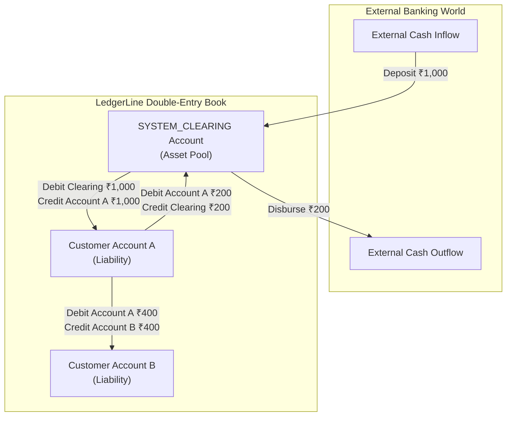

# LedgerLine — Comprehensive Architecture & Engineering Specification

## 1. Overview & Architectural Goals

LedgerLine is built to provide an unforgeable, provable ledger of money movements. Financial systems cannot tolerate lost updates, precision drift, unrecorded refusals, or uncoordinated state changes.

This document serves as the authoritative technical specification for LedgerLine's core domain, accounting engine, database design, and concurrency controls.

---

## 2. Double-Entry Accounting Model & Chart of Accounts

In LedgerLine, money cannot appear from or disappear into nothingness. Every posted financial transaction creates at least two balanced entries: a **Debit** and a **Credit**, satisfying:

$$\sum \text{Debits} - \sum \text{Credits} = 0.00 \text{ INR}$$

### Chart of Accounts
- **Customer Accounts (Liability Accounts)**: Represent deposits held by the bank on behalf of customers.
  - Normal Balance: Credit.
  - Increases with **Credit** (deposits, received transfers).
  - Decreases with **Debit** (withdrawals, sent transfers).
- **`SYSTEM_CLEARING` Account (Asset / Clearing Account)**: Dedicated internal account (`ACC-SYSTEM-CLEARING-001`) representing external cash reserves in the banking system.
  - Normal Balance: Debit.
  - Increases with **Debit** (external money entering the bank).
  - Decreases with **Credit** (external money disbursed to customers).

---

### Transaction Accounting Specifications



#### A. External Deposit (e.g., ₹1,000.00 into Account A)
External funds enter the bank's custody and are credited to the customer:
1. **Debit**: `SYSTEM_CLEARING` account by `₹1,000.00` (Clearing asset increases).
2. **Credit**: `Account A` by `₹1,000.00` (Customer liability increases).
- **Balance Equation**: $\text{Debit (₹1,000.00)} - \text{Credit (₹1,000.00)} = 0.00 \text{ INR}$.

#### B. External Withdrawal (e.g., ₹200.00 from Account A)
Customer requests funds disbursed to an external endpoint:
1. **Debit**: `Account A` by `₹200.00` (Customer liability decreases).
2. **Credit**: `SYSTEM_CLEARING` account by `₹200.00` (Clearing asset decreases).
- **Balance Equation**: $\text{Debit (₹200.00)} - \text{Credit (₹200.00)} = 0.00 \text{ INR}$.
- **Condition**: `Account A.balance - ₹200.00 >= 0.00`.

#### C. Internal Transfer (e.g., ₹400.00 from Account A to Account B)
Peer-to-peer reallocation between customers; `SYSTEM_CLEARING` is untouched:
1. **Debit**: `Account A` (Source) by `₹400.00` (Account A liability decreases).
2. **Credit**: `Account B` (Destination) by `₹400.00` (Account B liability increases).
- **Balance Equation**: $\text{Debit (₹400.00)} - \text{Credit (₹400.00)} = 0.00 \text{ INR}$.
- **Condition**: `Account A.balance - ₹400.00 >= 0.00`.

#### D. Reversal Accounting
Posted entries are immutable. Reversals create new compensating entries:
- Reversal of $A \rightarrow B$ for ₹400.00:
  - **Debit**: `Account B` by `₹400.00`.
  - **Credit**: `Account A` by `₹400.00`.
  - Condition: `Account B.balance - ₹400.00 >= 0.00`.

---

## 3. Money Conservation Invariant & Proofs

The global system invariant guarantees that total customer liabilities equal the net balance of the clearing account:

$$\sum_{i=1}^{N} \text{Balance}(\text{Customer Account}_i) = \text{Balance}(\text{SYSTEM\_CLEARING}) = \sum \text{External Deposits} - \sum \text{External Withdrawals}$$

$$\text{Net Position} = \text{Balance}(\text{SYSTEM\_CLEARING}) - \sum_{i=1}^{N} \text{Balance}(\text{Customer Account}_i) \equiv 0.00 \text{ INR}$$

### Numerical Lifecycle Verification
1. **Initial State**:
   - Customer Accounts: `₹0.00`, Clearing Account: `₹0.00`.
   - $\text{Net Position} = 0.00 - 0.00 = \mathbf{0.00 \text{ INR}}$.
2. **Deposit ₹1,000.00 into Account A**:
   - Account A: `₹1,000.00`, Clearing: `₹1,000.00`.
   - $\text{Net Position} = 1000.00 - 1000.00 = \mathbf{0.00 \text{ INR}}$.
3. **Internal Transfer ₹400.00 from Account A to Account B**:
   - Account A: `₹600.00`, Account B: `₹400.00` (Total Customer: `₹1,000.00`).
   - Clearing: `₹1,000.00`.
   - $\text{Net Position} = 1000.00 - 1000.00 = \mathbf{0.00 \text{ INR}}$.
4. **Withdrawal ₹200.00 from Account A**:
   - Account A: `₹400.00`, Account B: `₹400.00` (Total Customer: `₹800.00`).
   - Clearing: `₹800.00`.
   - $\text{Net Position} = 800.00 - 800.00 = \mathbf{0.00 \text{ INR}}$.

---

## 4. Standardized INR Monetary Representation

- **Currency Code**: Strictly `INR` (Indian Rupee, ISO 4217).
- **Database Column**: `DECIMAL(19, 2)` across all balances, amounts, and ledger records.
- **Java Type**: `java.math.BigDecimal` with scale 2 (`RoundingMode.UNNECESSARY`).
- **Precision Validation**: Any request with $>2$ decimal places (e.g., `100.255`) is rejected with HTTP `400 Bad Request`.
- **Zero & Negative Protection**: All transaction amounts must be strictly greater than zero (`amount.compareTo(BigDecimal.ZERO) > 0`).
- **No Silent Rounding**: The application never rounds or truncates monetary values submitted by users.

---

## 5. Idempotency Architecture (Single Atomic Transaction)

All mutating financial requests require an `Idempotency-Key` header scoped by `user_id` and `operation_type`.

```sql
CREATE TABLE idempotency_keys (
    id BIGINT AUTO_INCREMENT PRIMARY KEY,
    user_id BIGINT NOT NULL,
    operation_type VARCHAR(32) NOT NULL, -- 'TRANSFER', 'DEPOSIT', 'WITHDRAWAL'
    idempotency_key VARCHAR(128) NOT NULL,
    request_hash VARCHAR(64) NOT NULL,   -- SHA-256 of canonical JSON payload
    status VARCHAR(20) NOT NULL,         -- 'COMPLETED'
    response_status INT NOT NULL,        -- e.g. 200, 422
    response_body TEXT NOT NULL,
    created_at TIMESTAMP NOT NULL DEFAULT CURRENT_TIMESTAMP,
    CONSTRAINT uq_user_op_key UNIQUE (user_id, operation_type, idempotency_key),
    CONSTRAINT fk_idem_user FOREIGN KEY (user_id) REFERENCES users(id) ON DELETE CASCADE
) ENGINE=InnoDB;
```

### Atomic Execution Lifecycle
1. **Incoming Request**: Check `idempotency_keys` table inside the financial `@Transactional` boundary using `FOR UPDATE`.
2. **If Key Exists**:
   - Verify SHA-256 hash of payload against `request_hash`.
   - If hash matches: Return cached `response_status` and `response_body` immediately. No financial logic is re-run.
   - If hash differs: Throw `IdempotencyPayloadMismatchException` (HTTP `409 Conflict`).
3. **If Key Does Not Exist**:
   - Insert key with `status = 'COMPLETED'`.
   - If a concurrent duplicate arrives, the unique constraint `uq_user_op_key` raises a `DuplicateKeyException`, causing the duplicate transaction to roll back and query the completed response.
   - Execute balance updates, ledger entries, and statement events.
   - Cache final response status and payload into the idempotency row.
   - **Commit**: Everything commits atomically or rolls back completely.

---

## 6. Concurrency Safety, Deadlock Elimination & Retries

### Deterministic Lock Acquisition Order
To prevent deadlocks when concurrent transfers cross paths ($A \rightarrow B$ and $B \rightarrow A$):
```java
Long firstLockId = Math.min(sourceId, destId);
Long secondLockId = Math.max(sourceId, destId);

Account first = accountRepository.findByIdForUpdate(firstLockId);
Account second = accountRepository.findByIdForUpdate(secondLockId);
```
All concurrent threads acquire row locks in ascending primary key order, eliminating circular wait graphs.

### Spring Aspect Ordering for Fresh Transaction Retries
When transient lock acquisition timeouts occur:
```java
@Service
public class TransferService {

    @Retryable(
        retryFor = { CannotAcquireLockException.class, DeadlockLoserDataAccessException.class },
        maxAttempts = 3,
        backoff = @Backoff(delay = 50, multiplier = 2.0, random = true)
    )
    @Transactional(
        isolation = Isolation.READ_COMMITTED,
        rollbackFor = Exception.class,
        propagation = Propagation.REQUIRES_NEW
    )
    public TransferResponseDTO executeTransfer(...) { ... }
}
```
- `@Retryable` wraps `@Transactional`.
- When a lock timeout occurs, the inner transaction rolls back completely (discarding any partially inserted idempotency record).
- The retry advice opens a **fresh transaction** on a clean connection.

---

## 7. Statement Ordering & Deterministic Running Balances

Every account maintains an internal monotonic sequence counter:
```sql
CREATE TABLE statement_events (
    id BIGINT AUTO_INCREMENT PRIMARY KEY,
    account_id BIGINT NOT NULL,
    sequence_number BIGINT NOT NULL,
    initiating_user_id BIGINT NOT NULL,
    transaction_id VARCHAR(36) NULL,
    event_type VARCHAR(30) NOT NULL,
    amount DECIMAL(19, 2) NOT NULL,
    running_balance DECIMAL(19, 2) NOT NULL,
    status VARCHAR(20) NOT NULL,     -- 'POSTED', 'REFUSED'
    reason VARCHAR(255) NULL,
    created_at TIMESTAMP NOT NULL DEFAULT CURRENT_TIMESTAMP,
    CONSTRAINT uq_account_sequence UNIQUE (account_id, sequence_number),
    CONSTRAINT chk_stmt_running_balance CHECK (running_balance >= 0.00),
    CONSTRAINT fk_stmt_acc FOREIGN KEY (account_id) REFERENCES accounts(id) ON DELETE RESTRICT,
    CONSTRAINT fk_stmt_user FOREIGN KEY (initiating_user_id) REFERENCES users(id) ON DELETE RESTRICT,
    INDEX idx_stmt_acc_seq (account_id, sequence_number)
) ENGINE=InnoDB;
```
- While holding the account lock `FOR UPDATE`:
  - `sequence_number` is monotonically incremented.
  - If **POSTED**: `running_balance = old_balance ± amount`.
  - If **REFUSED**: `running_balance = old_balance` (unchanged).
- Statements are ordered by `sequence_number ASC`, eliminating timestamp ambiguities.

---

## 8. Reversal Safety with MySQL Generated Columns

Duplicate successful reversals are prevented using a virtual generated column and unique constraint:
```sql
ALTER TABLE transactions
    ADD COLUMN original_transaction_id VARCHAR(36) NULL,
    ADD COLUMN reversal_target_id VARCHAR(36) GENERATED ALWAYS AS (
        CASE 
            WHEN type = 'REVERSAL' AND status = 'POSTED' THEN original_transaction_id 
            ELSE NULL 
        END
    ) STORED,
    ADD CONSTRAINT fk_tx_original FOREIGN KEY (original_transaction_id) REFERENCES transactions(id),
    ADD CONSTRAINT uq_single_successful_reversal UNIQUE (reversal_target_id);
```
- Multiple `NULL` values are permitted in MySQL unique indexes (allowing unlimited normal transfers and refused reversals).
- A second successful reversal of the same transaction yields a non-null duplicate `reversal_target_id`, which MySQL rejects.

---

## 9. Privilege Separation & Immutability Triggers

### User Roles at Database Level
1. **Migration User (`ledgerline_migrator`)**:
   - Used by Flyway at boot/deployment.
   - Privileges: `SELECT, INSERT, UPDATE, DELETE, CREATE, DROP, ALTER, INDEX, REFERENCES, TRIGGER` on `ledgerline_db.*`.
2. **Runtime User (`ledgerline_app`)**:
   - Used by the Spring Boot connection pool.
   - Privileges: `SELECT, INSERT, UPDATE` on operational tables (`accounts`, `transactions`, `idempotency_keys`, `users`, `account_permissions`).
   - Privileges: `SELECT, INSERT` ONLY on audit/ledger tables (`ledger_entries`, `statement_events`, `audit_records`).
   - Zero DDL privileges (`DROP`, `ALTER`, `CREATE`, `TRUNCATE`, `TRIGGER` are strictly forbidden).

### Engine-Level Immutability Triggers
```sql
DELIMITER //
CREATE TRIGGER trg_ledger_prevent_update
BEFORE UPDATE ON ledger_entries FOR EACH ROW
BEGIN
    SIGNAL SQLSTATE '45000' SET MESSAGE_TEXT = 'VIOLATION: ledger_entries is append-only.';
END;
//
CREATE TRIGGER trg_ledger_prevent_delete
BEFORE DELETE ON ledger_entries FOR EACH ROW
BEGIN
    SIGNAL SQLSTATE '45000' SET MESSAGE_TEXT = 'VIOLATION: ledger_entries is append-only.';
END;
//
DELIMITER ;
```
*(Identical triggers protect `statement_events`).*
